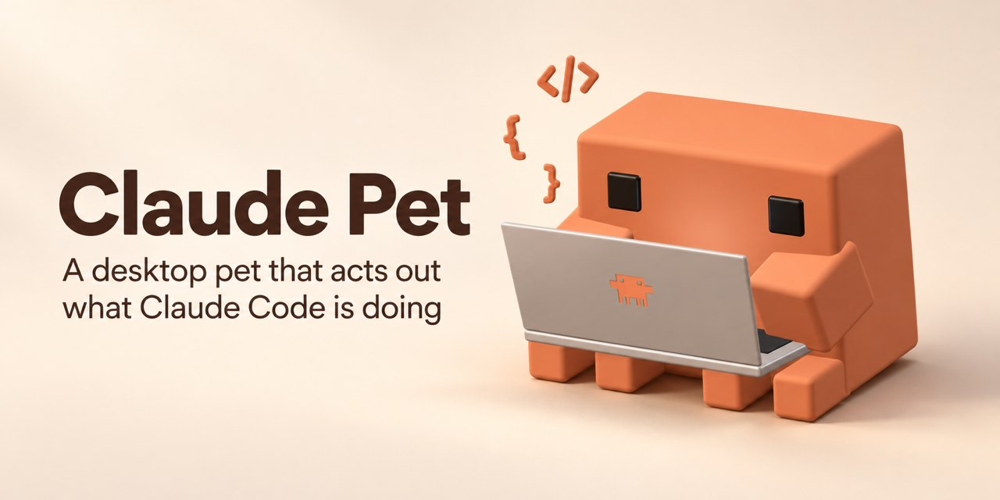
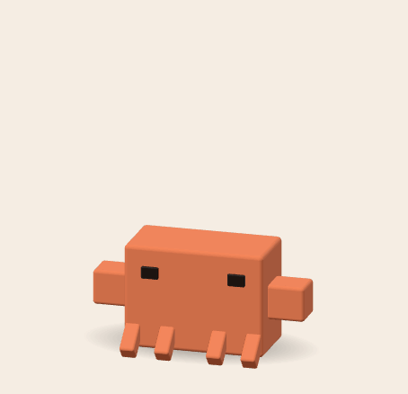
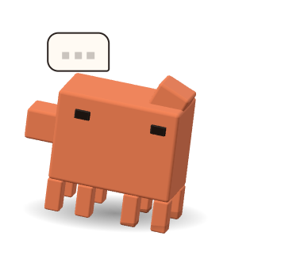
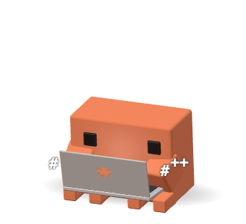
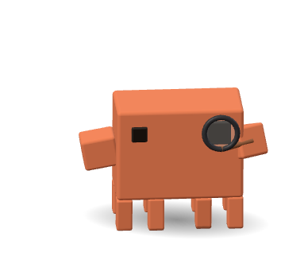
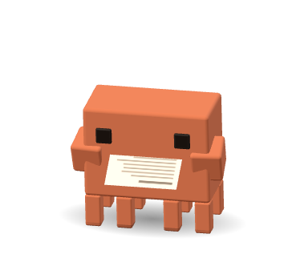
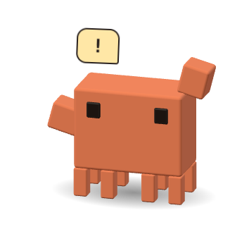
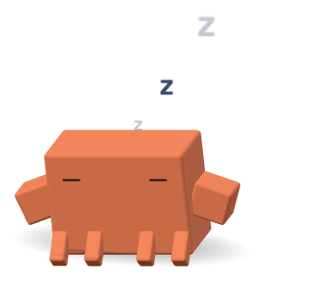

# Claude Pet

[](https://github.com/nervouna/claude-pet/releases/latest)

[](LICENSE)



A 3D voxel version of the little Claude Code mascot that lives on your macOS desktop and acts out what Claude Code is doing. It runs locally as an Electron app and learns what Claude is doing from Claude Code hooks that post to it on `127.0.0.1`.

<p align="center"></p>

<table>
  <tr>
    <td align="center"><br>Thinking</td>
    <td align="center"><br>Editing, running commands</td>
    <td align="center"><br>Searching</td>
  </tr>
  <tr>
    <td align="center"><br>Reading a file</td>
    <td align="center"><br>Needs you</td>
    <td align="center"><br>Asleep</td>
  </tr>
</table>

## Status

- **For** people who use Claude Code (terminal, desktop app or IDE) on a Mac and like something to look at while it works.
- **Maturity**: new (0.1), used daily by its author. Tested on macOS 27 only; it should run on macOS 13 and later (Electron 45's minimum). Linux has not been tested.
- **Needs** Node.js and npm to run from source, and `curl` for the hooks (preinstalled on macOS). No accounts or API keys.
- **Releases** are source only; there is no prebuilt app. Run it from a clone as described below.
- **Unofficial**: a fan project, not affiliated with or endorsed by Anthropic. Claude, Claude Code and the Claude Code mascot belong to Anthropic; the MIT license covers this project's code, not the mascot's design.

Bug reports and fixes are welcome, see [CONTRIBUTING.md](CONTRIBUTING.md). Report security problems privately as described in [SECURITY.md](SECURITY.md).

## Run

```bash
npm install
npm start
```

The pet appears in the bottom-right corner and adds a menu bar icon (Size, Play Demo, Reset Position, Quit). The window is transparent, always on top and click-through everywhere except on the pet itself. Drag the pet to move it, click it to poke it, right-click it for the same menu.

**Play Demo** feeds a scripted session through the same pipeline as real hooks, so you can see every animation without running Claude Code.

### Run with PM2

If PM2 is already installed, run these commands from the project directory:

```bash
pm2 start ecosystem.config.cjs
pm2 save
```

The configuration manages one Electron process, including the pet window and hook server. Run PM2 in your logged-in macOS desktop session. `pm2 save` includes the pet in the saved process list for `pm2 resurrect`; it does not configure login startup.

Use `pm2 status claude-pet` to check it, `pm2 restart claude-pet` to restart it, and `pm2 stop claude-pet` to stop it. PM2 automatically restarts the pet after it exits, including when you choose **Quit Claude Pet** from the menu. After changing its saved running or stopped state, run `pm2 save` again.

## Connect Claude Code

The pet listens on `127.0.0.1:46821` (override with `CLAUDE_PET_PORT`). Claude Code reports to it through hooks that `curl` each hook payload there. Install them into your user settings:

```bash
npm run hooks:install
```

This edits `${CLAUDE_CONFIG_DIR:-~/.claude}/settings.json` (following symlinks); pass `--settings <path>` to `node scripts/hooks.mjs install` to target another file, `npm run hooks:uninstall` removes them again, and `node scripts/hooks.mjs print` shows the JSON to paste by hand. The hook never fails or slows a session: when the pet isn't running, curl gets "connection refused" immediately and the hook exits 0. Claude Code usually picks up new hooks in running sessions too; restart a session that stays silent.

## What it does when

| Claude Code | Hook | Pet |
| --- | --- | --- |
| Thinking about your prompt or between tool calls | `UserPromptSubmit`, `PostToolUse` | Scratches its head, looks left and right, taps a foot, paces; "…" bubble |
| `Edit`, `Write`, `Bash`, MCP and other tools | `PreToolUse` | Sits down, pulls a laptop from behind its back, types; code (or shell) glyphs float out |
| `Grep`, `Glob`, `WebSearch`, `WebFetch` | `PreToolUse` | Holds a magnifying glass to one (now huge) eye and sweeps around |
| `Read` | `PreToolUse` | Reads a sheet of paper line by line, flipping pages |
| Waiting for permission or an answer | `PermissionRequest`, `Notification`, `AskUserQuestion` | Waves, hops, "!" or "?" bubble |
| Turn finished | `Stop` | Jumps, spins and throws sparkles (a small hop if another session is still busy) |
| Tool failed or API error | `PostToolUseFailure`, `StopFailure` | Startled shake |
| Compacting context | `PreCompact` | Gets squashed flat, pops back |
| New session | `SessionStart` | Stretches awake |
| Nothing for 5 minutes | — | Sits down and sleeps (Zzz) |

With several sessions at once the pet shows the one that matters most: needs-you beats working beats thinking. Short gaps between tool calls don't make it put the laptop away. A session stuck in one state for a long time (an interrupted turn sends no `Stop`) falls back to idle. The menu bar menu lists sessions and what each is doing.

When idle it wanders, hops, stretches, sits, occasionally dances, blinks, and follows your cursor with its eyes.

## Privacy

Nothing leaves your machine. The hooks send each hook payload, which includes your prompts and tool inputs such as file contents and commands, only to the pet on `127.0.0.1`. The pet keeps just the session id, the project folder name, the current state and the tool name in memory, and does not log or store payloads. Its own settings (size and window position) are in `~/Library/Application Support/claude-pet/settings.json`.

## Uninstall

Quit the pet from its menu, run `npm run hooks:uninstall`, then delete the clone and `~/Library/Application Support/claude-pet`.

## Develop

`npm run preview` serves the repo; open <http://127.0.0.1:5178/src/renderer/index.html> for the renderer in a normal browser with buttons for every state. `?zoom=3` scales it up, `?az=60&el=20` moves the camera. In the console, `pet.setState('Edit')`, `pet.pulse('celebrate')` and `pet.advance(2)` (step the simulation synchronously) help with tuning.

- `src/main/` — Electron main process: window, menu bar, cursor feed, the hook server (`server.js`) and the session state machine (`sessions.js`).
- `src/renderer/model.js` — the voxel pet and its pose channels; `props.js` — laptop, magnifier, paper, shadow.
- `src/renderer/actions.js` — every animation as an action with intro, loop and outro; `brain.js` — picks the next action from Claude's state.
- `scripts/hooks.mjs` — installs the hooks.
- `scripts/record.js` and `scripts/build-media.py` — regenerate the README GIF and stills: `npx electron scripts/record.js /tmp/pet-frames`, then `uv run scripts/build-media.py /tmp/pet-frames docs/images`.
